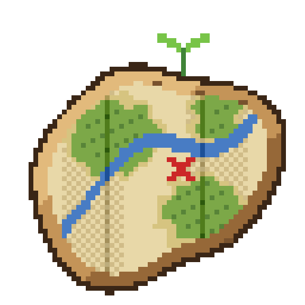

# Cartofold

**One map engine for the minimap, the world map, the paper maps and the maps of the other mods.**

Cartofold is a map mod for Minecraft (NeoForge). It needs no other mod. Install it on the server and on the client.

- **Minimap and map of the world**, with the caves at the height of the player.
- **Waypoints and banners** on all your maps, and in the world with their name and their distance.
- **Survey maps**: paper maps of their own, with a cartography table that moves and updates them.
- **API**: other mods add layers to all the maps, and show map frames in their own screens.

## Documentation

| Read | For |
| --- | --- |
| [Player guide](https://nicolas-goyon.github.io/Cartofold/guide/install/) | Install, keys, maps and settings |
| [API guide](https://nicolas-goyon.github.io/Cartofold/api/) | Use Cartofold in a mod |
| [Architecture](https://nicolas-goyon.github.io/Cartofold/technical/architecture/) | Understand the code |
| [Release notes](https://nicolas-goyon.github.io/Cartofold/release-notes/) | See the changes of each version |

## Contribute

Read [CONTRIBUTING.md](CONTRIBUTING.md) for the workflow, the build, the tests and the versions.

## License

[MIT](LICENSE)
