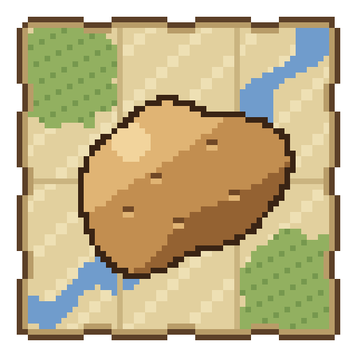

# Cartofold

{ width="128" }

Cartofold is a map mod for Minecraft 1.21.1 (NeoForge). It gives one map engine to all the maps of the game: the minimap, the map of the world, the paper maps and the maps of the other mods.

The name comes from *Kartoffel*: the German word for potato.

[Download on Modrinth](https://modrinth.com/project/cartofold){ .md-button .md-button--primary }
[Player guide](guide/install.md){ .md-button }

## Start here

- **Players**: read the [player guide](guide/install.md).
- **Mod developers**: read the [API guide](api.md), the [examples](api-examples.md), the [reference](api-reference.md) and the [Javadoc](https://nicolas-goyon.github.io/Cartofold/javadoc/io/github/nicolasgoyon/cartofold/api/package-summary.html).
- **Contributors**: read the [architecture](technical/architecture.md) and the [contribution guide](https://github.com/nicolas-goyon/Cartofold/blob/develop/CONTRIBUTING.md).
- **New versions**: read the [release notes](release-notes.md).

## Features

| Feature | Description |
| --- | --- |
| [Minimap](guide/maps.md#minimap) | Square or round, with five zoom levels. |
| [Map of the world](guide/maps.md#map-of-the-world) | The world that you explored, with a move and a zoom. |
| [Caves](guide/maps.md#caves) | The caves at your height, in bands of 16 blocks. |
| [Waypoints](guide/waypoints.md) | Your places, with a name and a color. |
| [Markers in the world](guide/waypoints.md#markers-in-the-world) | Your waypoints and the markers of the layers in the world, with their distance. |
| [Banners](guide/waypoints.md#banners) | The banners that you mark on a map show on your maps. |
| [Survey maps](guide/survey-maps.md) | Paper maps of Cartofold, with a cartography table that moves and updates them. |
| [API](api.md) | Layers, map frames and blocks that mark the paper maps. |
